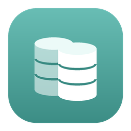
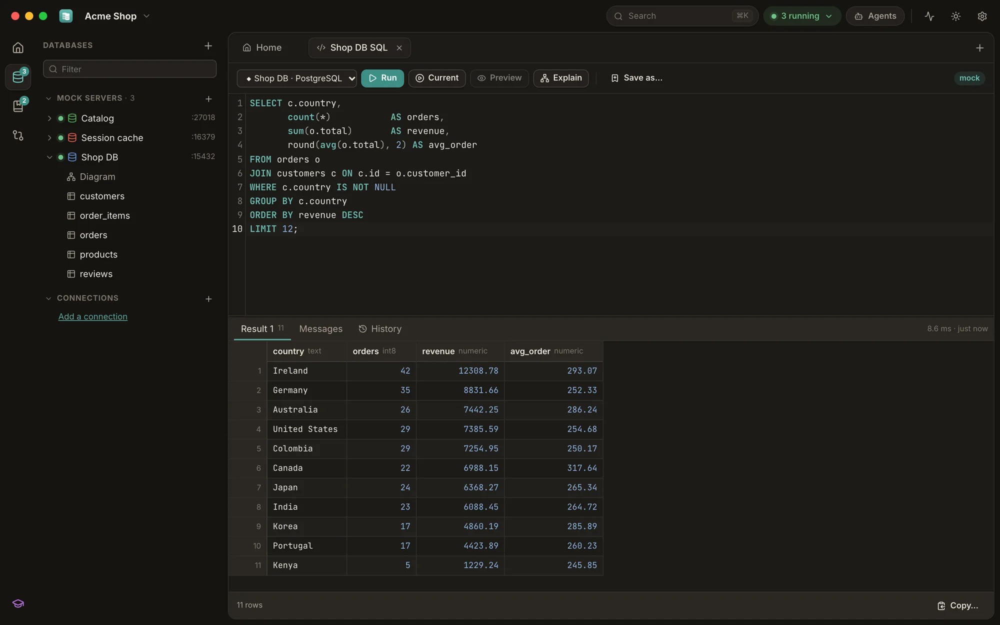
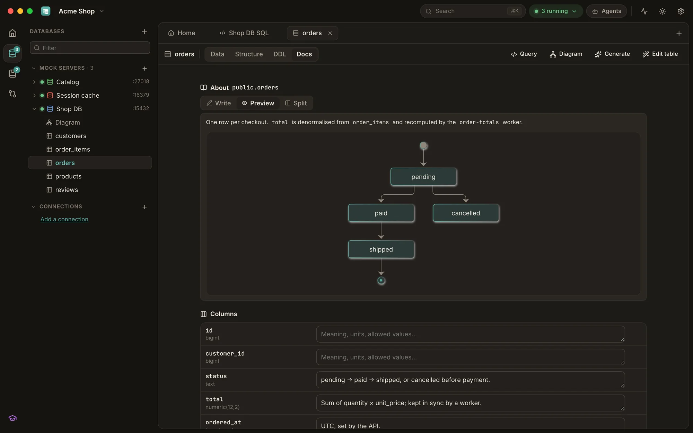
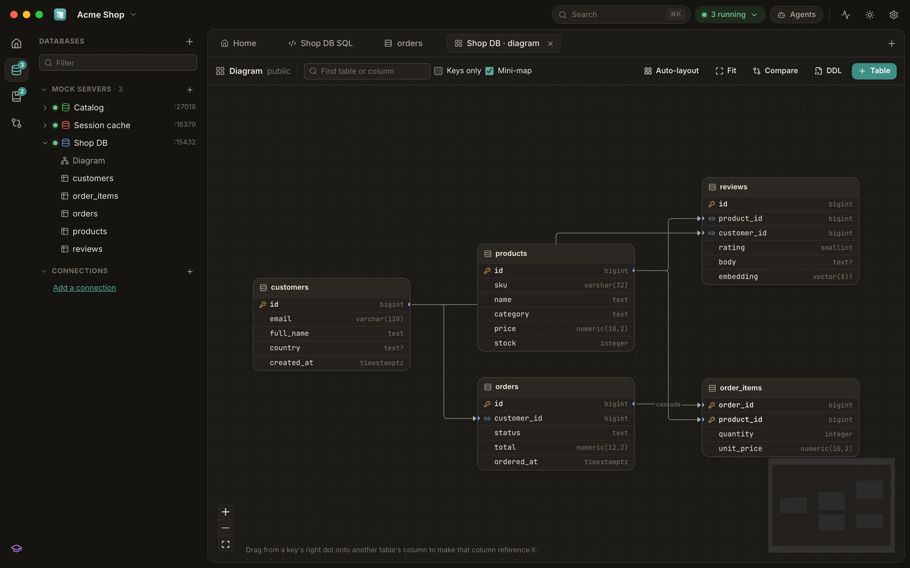
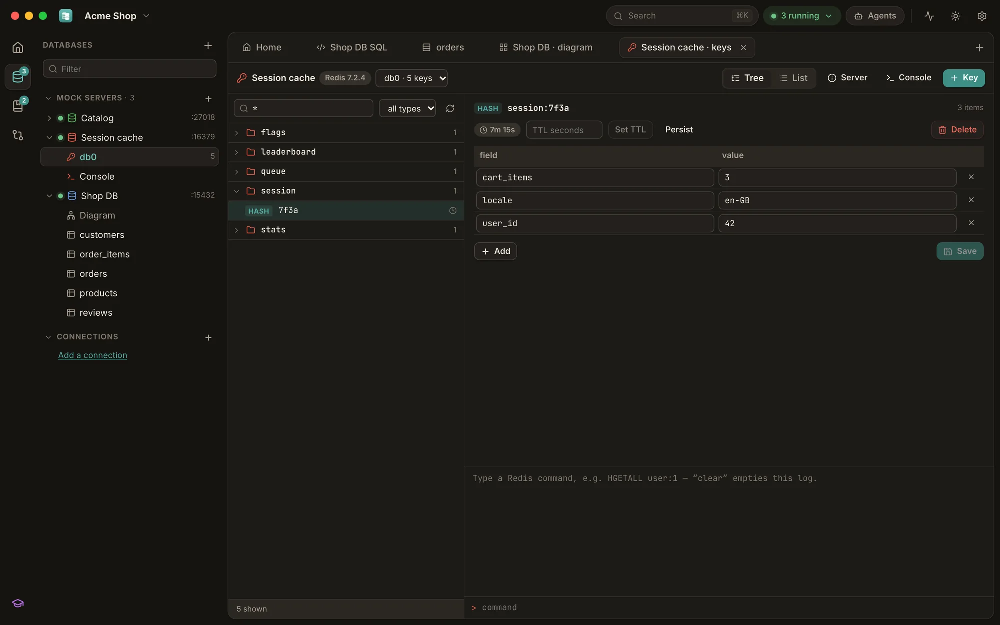
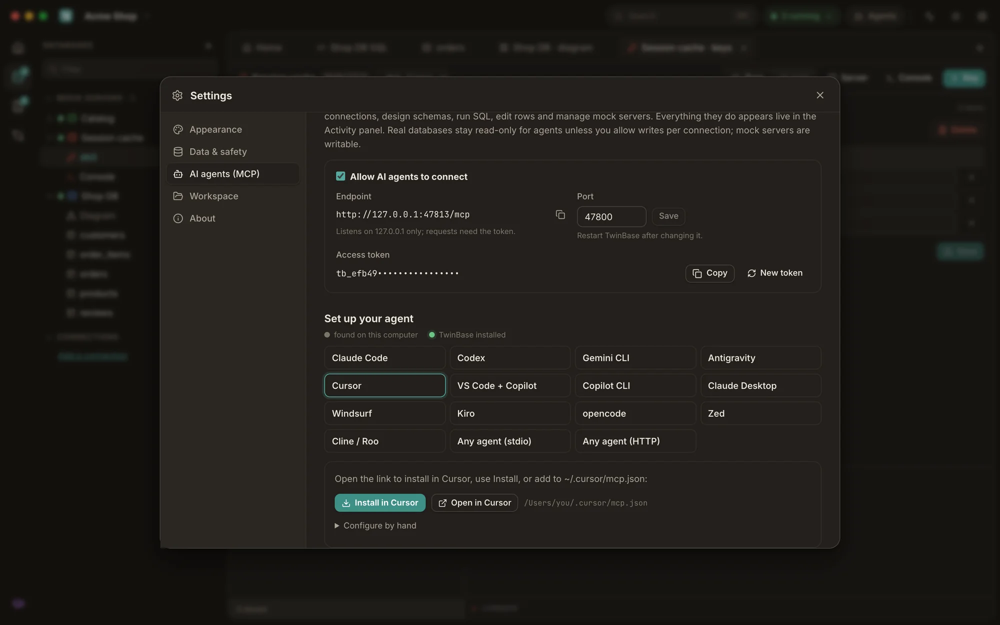
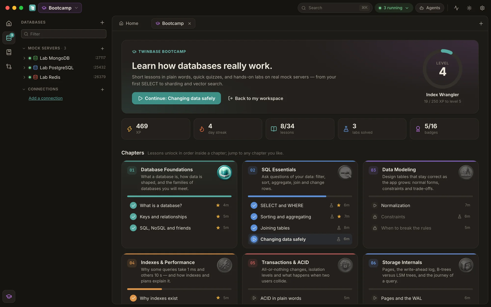
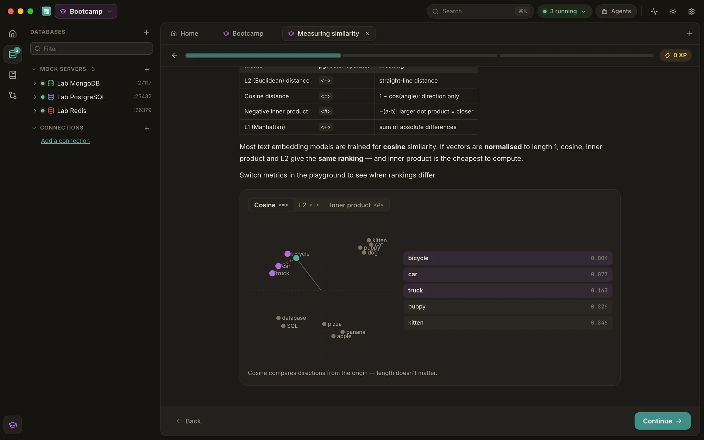

<p align="center">
  
</p>

<h1 align="center">TwinBase</h1>

<p align="center">
  <b>A database client and real database mock servers in one desktop app.</b><br>
  Browse and edit 14 kinds of databases, preview every change on a local twin before it runs,<br>
  and give your app a PostgreSQL (with pgvector), MySQL, SQL Server, Redis, MongoDB, DynamoDB or Firestore server in one click.<br>
  Learn how databases work in the built-in Bootcamp. Open source for Windows, macOS and Linux, and your coding agent can drive it.
</p>

<p align="center">
  <a href="https://github.com/LibreGuild/twinbase/releases/latest"></a>
  <a href="https://github.com/LibreGuild/twinbase/actions/workflows/ci.yml"></a>
  <a href="LICENSE"></a>
  
</p>

<p align="center">
  <a href="https://github.com/LibreGuild/twinbase/releases/latest"><b>Download</b></a> ·
  <a href="https://libreguild.github.io/twinbase/">Website</a> ·
  <a href="#features">Features</a> ·
  <a href="#mock-servers">Mock servers</a> ·
  <a href="#bootcamp">Bootcamp</a> ·
  <a href="#ai-agents">AI agents</a> ·
  <a href="#command-line">Command line</a> ·
  <a href="docs/">Docs</a> ·
  <a href="CONTRIBUTING.md">Contributing</a>
</p>

<p align="center">
  
</p>

## Why TwinBase
- **Mocks that are real servers.** Your application, ORM, migration tool or `psql`/`mysql`/`sqlcmd`/`mongosh`
  connects with its normal driver; only the host and port change. No Docker, no install, a few MB of memory.
- **See a change before it happens.** Run an `UPDATE` or `DELETE` on a local twin of the affected rows
  first: the preview shows every changed, added and removed row (cascades included), and the real
  commit is refused if the row count no longer matches.
- **One client for the databases you actually use** — SQL, documents, key-value and search, with the
  same grid, editors and diagrams.
- **Built for working with AI agents.** Claude Code, Codex, Gemini CLI, Cursor and any MCP client get
  tools for every feature, with per-connection access levels and a live activity log.
- **Learn while you build.** The Bootcamp teaches databases and system design with short lessons,
  quizzes and hands-on labs on real mock servers — with XP, levels and badges.
- **Document everything.** Markdown docs with Mermaid diagrams on the workspace, every connection,
  mock, table and column, kept as plain files next to your code.
- **Local and private.** No account, no cloud, no telemetry. Passwords live in your OS keychain.

## Features

### Database client
| | |
| --- | --- |
| **Databases** | PostgreSQL, MySQL/MariaDB, SQL Server/Azure SQL, Oracle, ClickHouse, Cassandra/ScyllaDB, Spanner, BigQuery, SQLite, Redis, MongoDB, DynamoDB, Firestore, Elasticsearch/OpenSearch |
| **Browse and edit** | Data grid with filters, sorting and paging; staged edits applied in one transaction with a row-count guard; JSON document and item editors |
| **Query** | SQL editor with completion and per-statement results; mongosh-style, DynamoDB, Firestore and Elasticsearch consoles; query history and saved queries |
| **Understand** | Query plans visualized (`EXPLAIN`/`SHOWPLAN`/Spanner and BigQuery plans) with index hints; ER diagrams; DDL export and conversion between dialects |
| **Change safely** | Change preview on a local twin; schema snapshots, diffs and generated migration scripts (up and down) |
| **Document** | Markdown and Mermaid docs for the workspace (README.md), connections, mocks, tables, columns, collections and saved queries |
| **Redis** | Numbered databases, namespace tree, typed editors (strings, hashes, lists, sets, sorted sets, JSON), streams, server info and a script console |
| **Connect** | TLS modes, SSH tunnels (keys, passwords, host-key checks), Google service accounts and ADC, Microsoft Entra tokens |

### Mock servers
| | |
| --- | --- |
| **Protocols** | PostgreSQL, MySQL, SQL Server (TDS), Redis (RESP2/3), MongoDB (OP_MSG, SCRAM), DynamoDB (HTTP, SigV4), Firestore (gRPC, `FIRESTORE_EMULATOR_HOST`) |
| **SQL engine** | TwinLite runs PostgreSQL, MySQL and T-SQL on SQLite with the real servers' types, catalogs (`pg_catalog`, `information_schema`, `sys.*`) and error codes; PostgreSQL mocks can also run on a real PostgreSQL installation |
| **Vectors** | pgvector built in: `vector`, `halfvec`, `sparsevec`, all distance operators and functions, HNSW/IVFFlat DDL — embedding code runs unchanged |
| **Workflow** | Seed scripts, capture current data as a seed, one-click reset, persistent or temporary data |
| **Testing** | Live traffic of every statement, fault injection (latency, errors by code, dropped connections, refused connections) |
| **Prototyping** | Visual table designer, schema templates, realistic sample data, ready-to-paste connection snippets for many stacks |

<table>
  <tr>
    <td></td>
    <td></td>
  </tr>
  <tr>
    <td></td>
    <td></td>
  </tr>
</table>

### Sharing
Workspaces are plain files you can keep in Git. A `.twinbase` bundle carries mocks (with data),
documented saved queries with expected results (scenarios) and schema snapshots in one file.

## Install
Download the [latest release](https://github.com/LibreGuild/twinbase/releases/latest):

| System | File |
| --- | --- |
| Windows 10/11 | `TwinBase-Windows-Setup-x64.exe` or the portable zip |
| macOS 11+ (Apple silicon and Intel) | `TwinBase-macOS-universal.dmg` |
| Linux x86_64 | `.deb`, `.rpm` or `.AppImage` |
| Command line only | `twinbase-cli-*` |

The builds are not code-signed yet. **Windows:** if SmartScreen appears, choose **More info → Run
anyway**. **macOS:** the first open is blocked; open System Settings → Privacy & Security → **Open
Anyway**. Checksums and build provenance attestations come with every release.

## Mock servers
Create one from the app (**+ → Mock …**) and paste the connection string it shows into your app.
The same mocks run headless for tests and CI:

```sh
twinbase mock postgres --port 5433 --seed db/schema.sql
psql "postgres://dev@127.0.0.1:5433/app"

twinbase mock mssql --port 1433          # sqlcmd -S 127.0.0.1,1433 -U sa -P x -C
twinbase mock mongodb --port 27017 --seed test/seed.json
```

Mocks accept any credentials by default (so existing configs work) or one user and password.
See [docs/mock-servers.md](docs/mock-servers.md) for what each protocol supports.

## Bootcamp
Click the graduation cap in the rail to learn how databases really work — ten chapters, from your
first `SELECT` to indexes, transactions, storage internals, Redis caching, sharding and vector
search. Each lesson is a few minutes of plain-language cards with interactive illustrations, then
quick checks (multiple choice, fill in the blank, match the pairs, put in order…) and hands-on labs
on real PostgreSQL, Redis and MongoDB mock servers. Earn XP, level up, keep a streak and collect
badges. The Bootcamp runs in its own workspace, so your projects are never touched.
See [docs/bootcamp.md](docs/bootcamp.md).

<p align="center">
  
  
</p>

## AI agents
TwinBase serves MCP on `http://127.0.0.1:47800/mcp` while it runs, and `twinbase mcp` bridges stdio
clients. **Settings → AI agents** detects the agents on your computer and sets each one up with a
one-line command or a single **Install** click (Claude Code, Codex, Gemini CLI, Antigravity, Cursor,
VS Code + Copilot, Copilot CLI, Claude Desktop, Windsurf, Kiro, opencode, Zed, Cline and any MCP
client):

```sh
claude mcp add --transport http --scope user twinbase http://127.0.0.1:47800/mcp --header "Authorization: Bearer <token>"
codex mcp add twinbase -- twinbase mcp
twinbase agent install cursor        # or gemini, antigravity, vscode, windsurf, kiro, …
```

Agents can do everything you can: list and describe tables, run SQL, read and edit rows, preview
changes, explain queries, read and write docs, create and configure mocks, edit seeds and inject
faults, diff schemas, run saved-query scenarios, and export or import bundles. Saved connections are
read-only for agents by default: statements are checked with each database's own quoting rules and
then run in a read-only transaction. Everything an agent does appears in the **Activity** panel.
See [docs/mcp.md](docs/mcp.md).

## Command line
```text
twinbase mock <kind> [--port N] [--seed FILE] [--data DIR] [--user U --password P]
twinbase serve [--workspace DIR]          # mocks and MCP without the window
twinbase mcp                              # stdio bridge to a running TwinBase
twinbase agent install <agent>            # set up a coding agent
twinbase export -o FILE / import FILE     # bundles
```
See [docs/cli.md](docs/cli.md).

## Build from source
```sh
git clone https://github.com/LibreGuild/twinbase.git
cd twinbase/apps/desktop
npm ci
npx tauri dev          # the desktop app with hot reload
npm run package        # installers for this system, with the CLI inside
```
Prerequisites and the test suites are in [CONTRIBUTING.md](CONTRIBUTING.md) and
[docs/development.md](docs/development.md).

## Repository layout
| Path | What it is |
| --- | --- |
| `crates/engine` | TwinLite: SQLite-backed engine that emulates PostgreSQL, MySQL and SQL Server SQL, types and catalogs |
| `crates/mock` | Wire-protocol servers (PostgreSQL, MySQL, SQL Server, Redis, MongoDB, DynamoDB, Firestore) |
| `crates/firestore-proto` | Firestore v1 gRPC types generated from Google's protos (vendored) |
| `crates/client` | Drivers for real databases: introspection, paging, staged edits, transactions |
| `crates/core` | Application core: workspaces, mocks, JSON API, twin preview, sample data, bundles, MCP |
| `crates/cli` | The `twinbase` command: headless mocks, `serve`, MCP stdio bridge, export/import |
| `apps/desktop` | Tauri 2 desktop shell and the React/TypeScript UI |
| `docs/` | Architecture and user documentation |
| `plan.md` | Project plan, decisions and milestones |

## Documentation
[Architecture](docs/architecture.md) ·
[Desktop app](docs/desktop-app.md) ·
[Mock servers](docs/mock-servers.md) ·
[TwinLite engine](docs/engine.md) ·
[Database client and change preview](docs/client.md) ·
[AI agents (MCP)](docs/mcp.md) ·
[Workspaces and bundles](docs/workspace-format.md) ·
[CLI](docs/cli.md) ·
[Bootcamp](docs/bootcamp.md) ·
[Development](docs/development.md) ·
[Releasing](docs/releasing.md) ·
[Performance](docs/performance.md)

## Community
Questions and ideas: [Discussions](https://github.com/LibreGuild/twinbase/discussions) ·
Bugs: [Issues](https://github.com/LibreGuild/twinbase/issues) ·
Security: [SECURITY.md](SECURITY.md) ·
Help: [SUPPORT.md](SUPPORT.md) ·
[Code of Conduct](CODE_OF_CONDUCT.md)

## License
TwinBase is developed by [LibreGuild](https://github.com/LibreGuild) and licensed under the
[Apache License 2.0](LICENSE).
